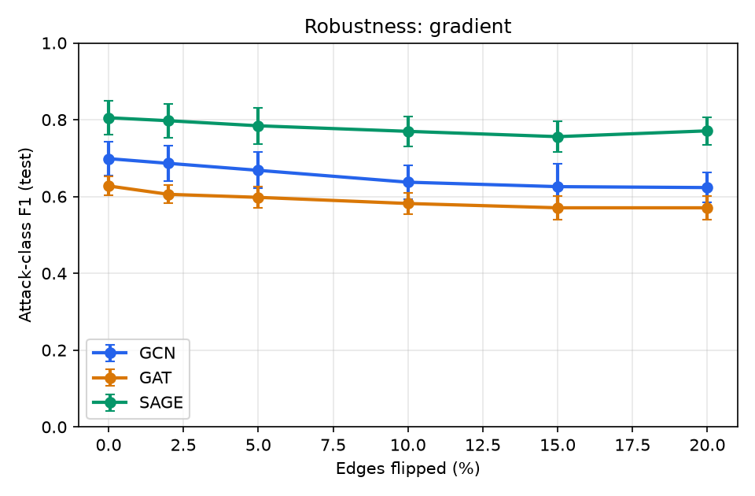
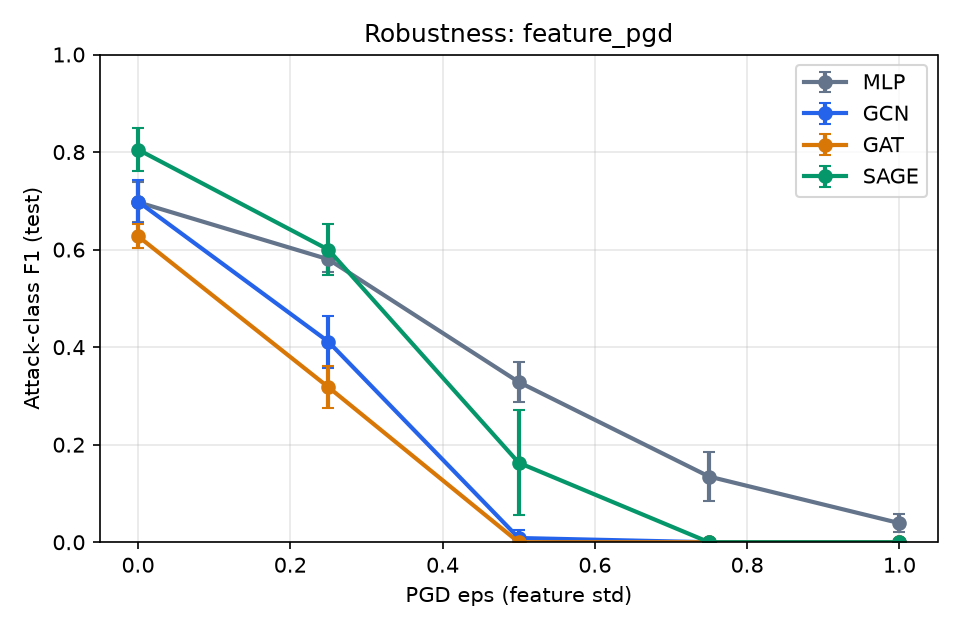
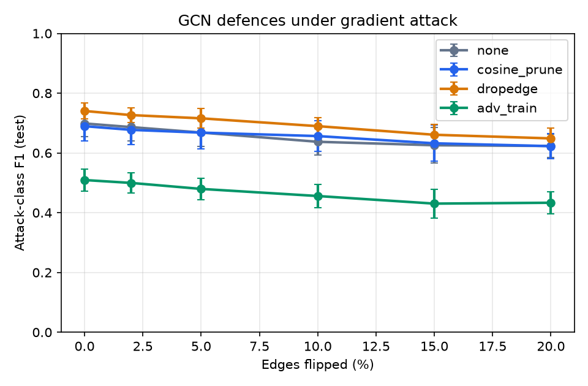

# GraphGuard IoT: Adversarial Robustness of GNN Intrusion Detection

How robust are Graph Neural Network intrusion detectors for IoT networks, and which defences actually help?

This repo trains GCN, GAT and GraphSAGE (plus a feature-only MLP control) to find compromised devices in an IoT communication graph. It then attacks them with structural and feature-space adversaries and measures how much each defence recovers. Every number on the [website](https://graphguard-iot.vercel.app/) comes from `results/results.json`, which this code produces.

By [Ziya Azizov](https://www.linkedin.com/in/ziya-azizov-91bba638a). Live site: **https://graphguard-iot.vercel.app**

## Results

5 seeds · 1,500 devices · ~4.8k links · 15% compromised · attack-class F1 on held-out test devices (mean ± std).

| Model | Defence | Clean | Random −10% | DICE 10% | Gradient 10% | PGD ε=0.5 |
|---|---|---|---|---|---|---|
| MLP | none | 0.697 ± 0.041 | — | — | — | 0.329 ± 0.042 |
| MLP | adv_train | 0.623 ± 0.029 | — | — | — | 0.359 ± 0.039 |
| GCN | none | 0.699 ± 0.045 | 0.693 ± 0.038 | 0.646 ± 0.034 | 0.637 ± 0.044 | 0.009 ± 0.017 |
| GCN | cosine_prune | 0.690 ± 0.049 | 0.659 ± 0.029 | 0.642 ± 0.037 | 0.656 ± 0.051 | 0.048 ± 0.037 |
| GCN | dropedge | 0.740 ± 0.026 | 0.726 ± 0.024 | 0.706 ± 0.021 | 0.690 ± 0.029 | 0.025 ± 0.032 |
| GCN | adv_train | 0.509 ± 0.037 | 0.507 ± 0.031 | 0.460 ± 0.028 | 0.456 ± 0.040 | 0.080 ± 0.062 |
| GAT | none | 0.627 ± 0.024 | 0.612 ± 0.034 | 0.552 ± 0.031 | 0.582 ± 0.028 | 0.000 ± 0.000 |
| GAT | cosine_prune | 0.609 ± 0.028 | 0.602 ± 0.024 | 0.537 ± 0.028 | 0.585 ± 0.009 | 0.024 ± 0.020 |
| GAT | dropedge | 0.605 ± 0.023 | 0.613 ± 0.033 | 0.539 ± 0.039 | 0.568 ± 0.021 | 0.009 ± 0.017 |
| GAT | adv_train | 0.484 ± 0.042 | 0.490 ± 0.042 | 0.431 ± 0.026 | 0.452 ± 0.052 | 0.086 ± 0.114 |
| SAGE | none | 0.805 ± 0.044 | 0.767 ± 0.043 | 0.737 ± 0.041 | 0.770 ± 0.039 | 0.163 ± 0.108 |
| SAGE | cosine_prune | 0.736 ± 0.046 | 0.729 ± 0.048 | 0.708 ± 0.044 | 0.715 ± 0.041 | 0.210 ± 0.053 |
| SAGE | dropedge | 0.731 ± 0.051 | 0.716 ± 0.059 | 0.693 ± 0.049 | 0.718 ± 0.058 | 0.240 ± 0.056 |
| SAGE | adv_train | 0.675 ± 0.052 | 0.652 ± 0.041 | 0.620 ± 0.043 | 0.650 ± 0.056 | 0.266 ± 0.073 |

### Key findings
1. **GraphSAGE is the only architecture that clearly uses the graph.** It reaches F1 0.81 (AUC 0.97). GCN (0.70) only ties the feature-only MLP (0.70), and GAT (0.63) falls below it. Compromised devices mostly neighbour benign ones (heterophily). GCN and GAT average a node with its neighbours and wash out its own signal, while SAGE keeps separate self and neighbour weights.
2. **Coordinated feature evasion is the dominant threat.** If every bot shifts its own traffic statistics by ε = 0.5 std (white-box PGD), F1 collapses to 0.01 (GCN), 0.00 (GAT) and 0.16 (SAGE). The MLP keeps 0.33. Bots are linked to each other, so their perturbations compound through message passing: the graph that helps detection also amplifies the attack.
3. **Structural attacks hurt less, and transfer imperfectly.** Flipping 10% of links costs 3–8 F1 points. The gradient attack, built on a GCN-like surrogate, is the strongest against GCN (−0.06) but transfers poorly to SAGE. Label-aware DICE is the strongest against GAT and SAGE.
4. **No defence is free, and none fixes feature evasion.** DropEdge is the best all-round choice for GCN (+0.04 clean F1 and more robust to structure). PGD adversarial training raises robust F1 under ε = 0.5 only modestly (SAGE 0.16 → 0.27, GCN 0.01 → 0.08), at a 13–19 point cost in clean F1.

Differences below about 0.05 F1 are within seed-to-seed noise (std ≈ 0.03–0.05).

  

## Setup

| | |
|---|---|
| **Task** | Node classification: benign vs compromised IoT device |
| **Graph** | Synthetic, 1,500 devices, ~4.8k links, 15% compromised (`src/dataset.py`) |
| **Features** | 16 per-device traffic statistics (pkt rate, SYN ratio, unique dst ports, ...) |
| **Split** | 60 / 20 / 20 stratified; early stopping on validation F1 |
| **Metric** | Attack-class **F1**, recall, ROC-AUC. Accuracy is misleading at 85/15 balance |
| **Seeds** | 5 (new graph + new initialisation each); mean ± std |
| **Setting** | Evasion: models trained clean, attacked at test time |

### Why synthetic, and how it is built
Public IoT datasets (TON_IoT, CIC-IoT-2023) are flow tables, not device graphs, and there is no standard recipe for building a graph from them. The generator makes every modelling assumption explicit:

- Benign devices talk to their **site gateway** and peers on the same site/VLAN.
- Compromised devices **coordinate with each other** (C2/P2P) and **probe other sites**.
- Each bot shifts a **random subset** of scan-related features by a random amount, so features alone are informative but not sufficient.

A sanity check is built in: a logistic regression on features alone reaches F1 ≈ 0.67, and adding 1-hop neighbourhood features raises it to ≈ 0.78. The graph helps, but it is not a giveaway.

### Attacks
| Attack | Type | Knowledge |
|---|---|---|
| Random removal / injection | structure | none |
| DICE (Waniek et al., 2018) | structure | labels |
| **Greedy adjacency-gradient** (FGA / Metattack family) | structure | grey-box: own SGC surrogate, transferred |
| Gaussian noise | features | none (sanity baseline) |
| **PGD evasion** (Madry et al., 2018) | features | white-box; **only bots change only their own features** |

Structural budget = fraction of undirected links flipped. Feature budget = L∞ radius in feature standard deviations.

### Defences
| Defence | Idea |
|---|---|
| Cosine pruning | GCN-Jaccard (Wu et al., 2019) for continuous features; threshold tuned on validation |
| DropEdge | Random link dropping during training (Rong et al., 2020). A regulariser, not adversarial training |
| PGD adversarial training | Train on PGD-perturbed bot features (Madry et al., 2018) |

## Reproduce

```bash
python -m venv .venv && source .venv/bin/activate      # Windows: .venv\Scripts\activate
pip install torch --index-url https://download.pytorch.org/whl/cpu
pip install -r requirements-dev.txt

pytest -q                                   # 16 tests, ~30 s
python -m src.evaluate --quick              # 2 seeds, ~5 min
python -m src.evaluate                      # full benchmark, 5 seeds
```

Single experiments:

```bash
python -m src.train --model sage            # train + save checkpoint
python -m src.attack --rate 0.1             # random / DICE
python -m src.attack_smart --rate 0.05      # gradient attack vs random
python -m src.attack_feature --eps 0.5      # PGD evasion
python -m src.defend --model gcn            # compare defences
python -m src.explain                       # GNNExplainer + fidelity
streamlit run dashboard.py                  # interactive lab
uvicorn src.api:app --reload                # REST API, docs at /docs
python -m http.server                       # website (index.html) at http://localhost:8000
```

## Layout

```
src/
  dataset.py        synthetic IoT graph generator (numpy core, deterministic)
  model.py          MLP / GCN / GAT / GraphSAGE
  utils.py          training loop, early stopping, imbalance-aware metrics
  attack.py         random + DICE structural attacks
  attack_smart.py   gradient-based structural attack
  attack_feature.py Gaussian + PGD feature evasion
  defend.py         cosine pruning, DropEdge, PGD adversarial training
  evaluate.py       full benchmark -> results/results.json + plots
  explain.py        GNNExplainer with Fidelity+/-
  api.py            FastAPI service running real experiments
dashboard.py        Streamlit lab
tests/              pytest suite
```

## Limitations
- The graph is synthetic. Absolute numbers say nothing about any real network; the **relative** behaviour of models, attacks and defences is the point.
- Only evasion attacks. Poisoning (attacking the training graph) is future work.
- The gradient attack uses a linear surrogate. Adaptive attacks that know the defence (e.g. against cosine pruning) would be stronger.
- Single transductive graph. No temporal dynamics.

## References
Kipf & Welling 2017 · Veličković et al. 2018 · Hamilton et al. 2017 · Wu et al. 2019 (SGC; GCN-Jaccard) · Zügner & Günnemann 2019 (Metattack) · Waniek et al. 2018 (DICE) · Madry et al. 2018 (PGD) · Rong et al. 2020 (DropEdge) · Ying et al. 2019 (GNNExplainer) · Amara et al. 2022 (fidelity)
